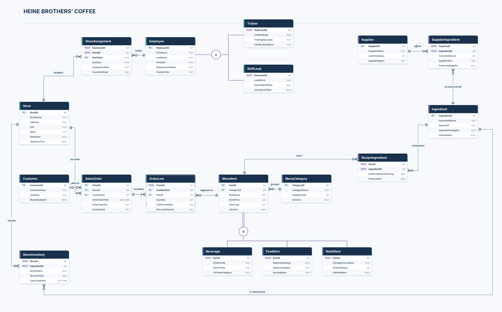

# Heine Brothers’ Coffee — Relational Database Design & SQL Analysis

An **independent academic case study** inspired by Heine Brothers’ Coffee, a Louisville coffee chain. The project demonstrates relational database design, crow’s foot entity–relationship modeling, keys and constraints, many-to-many relationships, subtype specialization, and SQL reporting using an **18-table SQLite database**.

> **Data disclaimer:** This project is unofficial and is not affiliated with Heine Brothers’ Coffee. The database design, operational records, employee information, inventory, suppliers, transactions, and query results are **synthetic**. It is not an actual Toast POS database or export.

## Entity–relationship diagram

- [`Heine_Brothers_ERD.drawio`](Heine_Brothers_ERD.drawio) — editable source (open at [diagrams.net](https://app.diagrams.net/))
- [`Heine_Brothers_ERD.pdf`](Heine_Brothers_ERD.pdf) — vector document for viewing at larger scale

The model demonstrates primary/foreign keys, one-to-many relationships, optional participation, composite keys, associative entities, and disjoint/overlapping specialization.

## Example SQL analysis

| Analysis | SQL concepts |
| --- | --- |
| Store revenue and completed-order volume | `JOIN`, `SUM`, `COUNT(DISTINCT)`, `GROUP BY`, `ORDER BY` |
| Top five beverages at Fern Creek | Multi-table `JOIN`, subtype filtering, aggregation, `LIMIT` |
| Inventory reorder candidates | `LEFT JOIN`, `COALESCE`, calculations, filtering |

The three executable queries are in [`Three_Sample_SQL_Queries.sql`](Three_Sample_SQL_Queries.sql); their example outputs are in `Query_1_Results.csv`, `Query_2_Results.csv`, and `Query_3_Results.csv`.

## Run the queries

1. Open [`heine_coffee_demo.sqlite`](heine_coffee_demo.sqlite) with **DB Browser for SQLite** or another SQLite-compatible client.
2. Open the **Execute SQL** tab.
3. Open `Three_Sample_SQL_Queries.sql`, or paste an individual `SELECT` statement from that file.
4. Run the statement and compare the results with the matching CSV file.

The demo database contains **18 tables**, **1,200 synthetic sales orders**, and **2,269 order lines**. It is a ready-to-query demonstration database; it does not include Heine Brothers’ production data.

## Repository files

| File | Purpose |
| --- | --- |
| `Heine_Brothers_ERD.png` | Diagram preview displayed above |
| `Heine_Brothers_ERD.drawio` | Editable diagram source |
| `Heine_Brothers_ERD.pdf` | Scalable ERD |
| `heine_coffee_demo.sqlite` | Synthetic SQLite dataset |
| `Three_Sample_SQL_Queries.sql` | Three sample analyses |
| `Query_1_Results.csv` | Store-level query output |
| `Query_2_Results.csv` | Beverage query output |
| `Query_3_Results.csv` | Inventory query output |

## Portfolio context

This work is intended to demonstrate university-level fundamentals in database design and SQL. Schema and transaction details are simulated for educational purposes.
